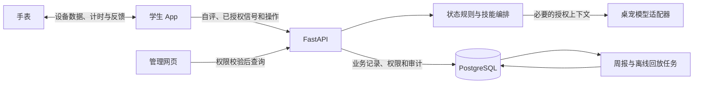

# 照见全栈开发实施计划

**依据**　《照见-项目计划书-双端与桌宠修订稿》及现有仓库 README。仓库目前主要有说明文件，以下目录、接口、页面和指标均为开发计划。

**首版口径**　学生端先做 Android 手机 App，管理端做网页，穿戴只接入一款通过验证的设备。桌宠是学生 App 首页可收起的 AI 助手。申报书正文写 10 秒快照、60 秒行动起步，功能表和演示脚本写 30 秒快照、90 秒起步。首版以 **30 秒内完成一次快照、常规行动 90 秒至 15 分钟** 为验收口径，时长由配置管理。周末兴趣实验使用独立配置。

**首版交付**　学生能从自评或桌宠进入状态卡，选行动，完成反馈，自愿打卡领成长卡。管理人员能查看所管班级概况和学生主动共享的摘要。手表缺失时，手机仍可完成这条流程。

## 1. 产品分区

| 端 | 导航及页面 | 功能 |
| --- | --- | --- |
| 学生 App | 首页 | 今日状态卡、照一照、设备同步提示、桌宠入口、行动推荐 |
| 学生 App | 行动 | 行动列表、详情、计时和退出、完成反馈、打卡确认 |
| 学生 App | 回顾 | 个人时间线、四维趋势、周报、充电与耗电线索、兴趣实验 |
| 学生 App | 我的 | 成长卡册、个人记忆、设备绑定、数据授权、共享设置、提醒、导出和清除 |
| 学生 App | 桌宠对话 | 文字咨询、状态依据、行动卡和周报入口、校园支持资源 |
| 管理网页 | 班级看板 | 在所管班级和年级内切换，查看参与人数、打卡活跃度及符合展示条件的群体趋势 |
| 管理网页 | 学生情况 | 授权学生列表、共享状态摘要、行动概况、学生主动提交的支持请求 |
| 管理网页 | 运营与审核 | 行动库、校园资源与证据库、SkillCard、工具白名单、版本发布与回滚、审计和运营指标 |
| 手表 | 提醒、计时和反馈 | 久坐提醒、行动开始与停止、剩余时间、震动、设备支持时的心率、一键反馈 |
| 耳机 | 学生主动播放 | 呼吸引导、白噪音、完成提示；由手机控制播放及停止 |

学生端状态卡用于解释当前状态，行动卡用于选择下一步，成长卡用于收藏打卡成果。三类卡片分别使用独立的数据结构和页面组件。

学生首页从上到下放置设备与同步状态、今日四维状态、“照一照”主按钮和推荐行动。桌宠放在页面边缘，允许收起和静音。管理端采用左侧导航、顶部班级和日期筛选、中央统计区。个人详情从授权列表进入，默认显示最近一次共享的摘要及其有效期。

## 2. 技术选型与工程结构

| 模块 | 语言与框架 | 主要职责 |
| --- | --- | --- |
| 学生 App | Dart、Flutter、Riverpod、Dio、Drift/SQLite | 页面与状态、REST 请求、本地计时、离线待同步操作 |
| Android 系统接入 | Kotlin，经 Flutter Platform Channel 调用 | Health Connect、系统授权、UsageStats、通知及拍摄模块的原生桥接 |
| 手表端 | Kotlin、Jetpack Compose for Wear OS、Wear OS Health Services 和 Data Layer | 手机与手表同步行动，处理设备能力、传感器与震动。选定设备须先实测上述能力 |
| 管理网页 | TypeScript、Vue 3、Vite、Vue Router、Pinia、Element Plus、ECharts | 权限导航、班级统计、授权摘要、运营配置 |
| 后端 | Python、FastAPI、Pydantic、SQLAlchemy、Alembic | 鉴权、输入校验、状态计算、业务服务、OpenAPI、数据库迁移 |
| 存储 | PostgreSQL | 用户、健康特征、行动、权限、发卡及审计。首版用关系表和时间索引 |
| AI 与视觉 | Python 侧封装 Qwen 适配器；Android 端 MediaPipe 与 OpenCV | 意图理解、结构化解释、可选端侧照片质量检测。语音转写在扩展阶段接入 |
| 部署与测试 | Docker Compose、GitHub Actions、pytest、Flutter Test、Vitest、Playwright | 本地起数据库与 API，构建两端，执行迁移和测试 |

后端先用**模块化单体**。账号权限、感知、状态、技能编排、行动、记忆、周报与运营分模块，部署一个 API 和一个按需启动的后台任务进程。离线复盘和周报任务可复用同一套业务模块。向量检索等有检索规模或准确度需求后再接入 pgvector。开发端以 FastAPI 生成的 OpenAPI 为接口契约。［[Flutter 原生桥接](https://docs.flutter.dev/platform-integration/platform-channels) · [Vue 与 TypeScript](https://vuejs.org/guide/typescript/overview.html) · [FastAPI 数据库示例](https://fastapi.tiangolo.com/tutorial/sql-databases/)］



```text
apps/student_app/             Flutter 页面、业务状态、本地待同步队列
apps/admin_web/               Vue 页面、路由、请求与图表
apps/wear_app/                手表提醒、计时、设备通信
backend/app/
  identity/                   登录、学生归属、角色、授权、共享
  signals/                    设备数据、情境、自评
  state/                      质量判断、个人基线、四维计算
  actions/                    推荐、会话、反馈、打卡与卡册
  assistant/                  桌宠、模型适配、输出校验
  memory/                     记忆管理、检索、删除
  reports/                    时间线、周报、兴趣实验
  management/                 班级看板、授权摘要、支持请求
  operations/                 SkillCard、资源库、发布、回放与审计
  safety/                     输入和输出安全检查
backend/migrations/           数据库迁移
backend/tests/                服务与接口测试
fixtures/demo/                虚构账户、数据与演示用例
```

## 3. 学生端功能实现

### 3.1 登录、首页与设置

- **前端**　首版用试点账号登录，首次进入可设置提醒时间、行动偏好和身体限制，也可直接跳过。首页加载今日状态、推荐和最近同步时间。每个数据源单独展示授权状态及关闭入口。
- **后端**　试点账号和班级由种子数据或受限导入创建。登录后通过会话识别用户，前端传来的角色和学生 ID 不能决定访问范围。手机会话凭证存系统安全存储，管理网页使用 HTTPS 和安全 Cookie，会话退出后服务端可撤销。
- **验收**　学生账户无法访问管理 API，退出后旧会话失效。授权未开启时，用户仍能用自评。

### 3.2 照一照与数据接入

- **前端**　用表情或简短选项记录自评，文字、语音、自拍均可跳过。手机同步页显示数据源、更新时间和缺失项。地点首版用学生手选的类别，日程只用“接下来可用多少分钟”或授权后的忙闲摘要。
- **后端**　分别保存自评与传感器聚合。同步请求带来源记录 ID、采集时间、单位和质量标记，使用用户、来源、来源记录 ID 去重。UTC 入库，按用户时区聚合。心率与活动以分钟桶对齐后取近期有效窗口，睡眠取最近完整睡眠段，屏幕使用按小时聚合。过期、重复、离线及未授权标为不同状态。保留设备来源，避免同一段步数被手机和手表重复累加。客户端在入库确认后推进同步游标，支持按时间窗口补传及处理源记录删除。
- **穿戴**　首个开发任务实测选定手表能否把心率、睡眠、步数写入手机 Health Connect，逐字段确认授权、更新时间和缺失率。HRV 仅在设备实际提供并注明计算口径时使用。实时行动心率走手表端能力探测。久坐首版依据可用活动记录估计，证据不足时只使用学生自报。屏幕时间可通过 Android UsageStats 获得授权后的聚合，手机本地汇总时长。［[Health Connect 数据类型](https://developer.android.com/health-and-fitness/health-connect/data-types) · [Wear OS 行动数据](https://developer.android.com/health-and-fitness/health-services/active-data) · [Android 使用统计](https://developer.android.com/reference/android/app/usage/UsageStatsManager)］
- **验收**　同一设备记录上传两次只计一次。拒绝授权、撤回权限或手表离线时均可自评。界面能区分真实、手动、缺失及演示数据。

### 3.3 四维状态卡与用户纠正

1. **处理输入**　对有效信号做时间对齐、质量检查和单位统一。按人和相近时间段计算最近有效记录的个人基线。冷启动用自评并明确显示“基线积累中”。首轮可用近 14 天内至少 5 个有效观测点作为基线启用条件，阈值随试用调整。
2. **按维度计算**　能量主要参考睡眠、活动及自评；紧绷参考自评和经质量检查的心率/HRV；恢复参考睡眠及相对基线；心情以自评为主。规则输出低、中、高或数据不足。有效来源越少、越旧或相互矛盾，置信度越低；缺失权重从分母移除，输入过少则返回数据不足。设备信号只支持对应维度。权重、阈值和规则版本可配置。
3. **展示解释**　学生端展示四维结果、置信度、数据来源时间和每卡最多三条依据。状态卡保存生成时的证据摘要与规则版本。允许学生点击“判断不准”，勾选维度及原因，更新后续证据权重。单次纠正写入事件。

**规则初版**　每项信号先经规则转成相对等级 `-1/0/+1`，分别表示该维度偏低、居中或偏高，未满足质量条件则缺失。可用项按配置权重和质量加权取平均，再按配置阈值分档。置信度另以有效覆盖率、时效和一致性计算，出现明确冲突时降档。缺少自评时，心情显示数据不足。基线用同一时间段的中位数与分位范围，避免极端值拉偏。规则权重和分档阈值先用虚构样例及访谈校准。

**验收**　同一输入和规则版本得到相同结果。单一心率信号无法推断心情。自评与设备信号冲突时标低置信度并提示补充信息，低置信度下减少推荐或仅记录。

### 3.4 行动推荐、执行和反馈

- **推荐**　Skill Controller 从已发布行动 SkillCard 取候选，按时间、场所、身体限制、已拒绝类别和安全等级硬过滤。剩余候选按「状态匹配 + 历史效果 + 偏好匹配 − 执行成本」的可配置加权分排序，同分按配置优先级与固定 ID 决定，最多三张。卡片说明推荐理由、预计时长、步骤、可能感受和跳过方式。无候选时给出“先记录一下”的出口。
- **执行**　学生确认开始后建立一次 `action_session`。手机和手表使用同一会话 ID 与操作序号，按「已开始 → 完成或退出」处理，暂停和恢复更新计时状态。端侧计时采用单调时钟，离线时保留待同步事件。终态和旧操作由服务端校验，重传返回已有结果。
- **反馈**　选择“更轻松 / 没变化 / 更累”，可跳过或在时间线补记。反馈写到同一会话，并作为后续推荐和记忆候选。耳机引导由学生主动触发，通话、停止或退出时结束播放。
- **验收**　在图书馆只剩 5 分钟时过滤掉 10 分钟行动；手表断开后手机可继续计时，重新连接同步后只生成一次完成记录。退出仍可记录感受。

### 3.5 桌宠 AI 助手

- **前端**　首页提供可收起的桌宠入口，点击后进入文字对话。首版提供“解释我的状态”“我现在能做什么”“回顾这周”三个快捷入口。回答可带状态卡、行动卡、周报和校园资源按钮，点击由学生确认。
- **后端**　请求先走输入风险检查，再做意图分类，支持日常咨询、状态解释、行动建议、周报回顾和校园资源。用本人会话和当前授权查询必要的结构化证据；一般问题可走通用建议。模型只生成结构化回答，字段含 `answer`、`evidence_ids`、`quick_actions`，服务端核验引用及按钮对象并做输出检查。超时或模型不可用时返回已审核模板或常用入口。聊天保存和长期记忆分别控制，用户可删除聊天；学生确认后才能将选定内容写入长期记忆。
- **验收**　能解释一张已有状态卡、推荐合适行动并打开对应页面。缺少数据时会询问学生感受或给通用选项。请求查看他人信息时无数据返回。触发高风险时直接返回固定支持信息和校园资源，停止普通推荐。

### 3.6 打卡与成长卡

- **前端**　完成自评或行动后显示“自愿打卡”和“跳过”。确认后展示成长卡及“查看卡册”。卡册按主题和领取时间展示。待同步时显示处理中，收到服务端结果后再显示发卡成功。
- **后端**　校验当前学生拥有且已完成该自评或行动。以 `(student_id, source_type, source_id)` 唯一约束创建打卡，成长卡记录以 `checkin_id` 唯一。资格检查、打卡和发卡在同一事务完成。并发重复或网络重试查询并返回原有卡。卡面模板由版本化配置管理，例如散步对应“走一走”，呼吸练习对应“慢下来”。［[PostgreSQL 冲突处理](https://www.postgresql.org/docs/current/sql-insert.html)］
- **验收**　两个客户端同时提交同一记录只发一张卡。未完成、已删除或他人记录无法领取。跳过打卡后可正常进入回顾。

### 3.7 时间线、周报与兴趣实验

- **前端**　时间线按本地日期展示状态、行动、反馈和已领卡。周报展示四维曲线及置信度、充电与耗电线索、一个兴趣实验。实验可接受、换一个、跳过并在完成后反馈投入感和复做意愿。
- **后端**　按本地周汇总，按学生和周唯一生成，支持任务重试。结合本人状态与行动的配对记录计算前后变化，标明样本量和证据强弱。工程初值可设至少 3 条同类有效配对才展示线索，低样本量只展示参与和状态描述。兴趣实验从反复选择、有效反馈或高投入活动中选，用安全规则和偏好筛选。数据删除或更正后使受影响周报失效并重算。
- **验收**　跨时区和跨周日期正确，无数据时给出空状态。线索注明“本周 3 次散步后自评有所变化”等关联，未发生的观察不出现在周报。

### 3.8 个人记忆、授权与数据管理

- **前端**　记忆中心分事件、模式、偏好、边界，显示来源、形成时间、有效期和使用过的场景。支持编辑、删除、按类暂停和清空。共享设置先预览字段、对象和有效期，学生确认后才创建授权。学生可查看现有授权并撤回。提醒可独立关闭。
- **后端**　Memory Controller 接收已授权的反馈事件，先以结构化字段检索最近相关记录；重复证据或学生主动确认后再形成模式和长期偏好。边界优先于推荐排序。删除/停用先从检索排除，再按来源失效或清理派生摘要、索引、缓存。导出任务生成本人 JSON/CSV；账号清除停止访问并清理业务表、缓存和派生数据。备份按预先定义的留存期轮换。
- **验收**　删掉一条偏好后，下次行动和桌宠检索无法引用。共享关闭后学生仍可正常使用 App。

### 3.9 可选语音、自拍和环境情境

| 功能 | 前端和采集 | 后端和验收 |
| --- | --- | --- |
| 语音自评 | 学生主动录制，可查看并更正转写文本。选择能在测试设备运行的端侧转写方案后接入 | 提交经确认的文本和必要特征，默认不上传录音。转写失败切换文字或表情，用户删除后不再用于检索 |
| 自拍观察 | 默认关闭。相机指引距离、姿态和避开直射光，端侧检测人脸、模糊、遮挡和曝光，保存前预览并提供跳过。连续两次质量不合格自动跳过 | 有可比个人基线且通过门控后，相对特征可作为低权重证据。先在少量固定设备上做光源估计、白平衡、色卡校正及同设备基线，评估 ΔE00 和 ICC，并按 Fitzpatrick I–VI 分层记录结果。强光、近期运动或暴晒影响无法区分时屏蔽或降权，原图留在端侧。差异达不到预设稳定性目标时关闭特征分支 |
| 天气、日程、地点 | 用户手选地点类别和可用时长；天气可用手选城市级位置 | 天气/UV 保留来源与更新时间，失败时跳过。日程只取忙闲摘要，地点只存类别。无授权或过期输入时行动仍可从学生提供的时间与地点筛选 |

## 4. 管理端功能实现

| 功能 | 网页实现 | 后端实现与验收 |
| --- | --- | --- |
| 班级概览 | 班级与日期筛选，展示参与人数、打卡活跃度、四维群体趋势 | 服务端按管理人员负责范围计算。对低样本量按配置抑制展示，例如少于 5 人的统计桶不展示趋势，限制筛选粒度，避免通过相邻条件反推个体 |
| 授权学生与详情 | 只在授权列表打开摘要，显示最近共享时间、字段和有效期 | 同时校验会话角色、班级范围、授权对象、字段和有效期。摘要只使用学生确认的快照。撤回后查询立即失效，个人摘要响应禁用共享缓存。跨班直接访问和列表筛选均无详情返回 |
| 支持请求 | 查看学生主动提交的请求与处理状态，支持更新“待查看 / 已查看 / 已处理” | 单独记录请求内容、接收人和状态变更，按学生选择的接收范围授权，不将桌宠聊天或高风险识别自动同步到管理端 |
| 行动、资源与证据库 | 搜索、编辑草稿、预览、版本历史 | 运营角色负责内容和技能配置，校验来源、时长、场所、风险和可用工具。校园支持资源由负责人员核对并发布 |
| SkillCard 与发布 | 查看卡片结构、试跑、内测开关、历史版本、回滚入口 | Action Skill Bank 保存触发条件、前置条件、工具权限、风险、输入输出与版本。Memory Skill Bank 保存抽取、检索、合并、衰减与遗忘规则。发布流程为草稿、离线回放、人工审核、生效或停用。灰度先用内测账号白名单，回滚切换至上一有效版本 |
| 审计与运营指标 | 按日期和事件类型看汇总，审计页查询权限范围内的记录 | 记录查看者、时间、操作、权限判定、资源 ID 与技能版本，日志不存原始健康数据、聊天正文和令牌。运营账号使用聚合指标与脱敏轨迹 |

## 5. 数据模型与接口约定

所有业务对象用 UUID 主键。跨账户资源查询在数据库条件中附带用户、班级或授权范围，响应使用白名单字段。时间字段使用带时区的时间类型，分组统计按用户或学校时区处理。

| 业务 | 表与主要字段 | 接口（统一前缀 `/api/v1`） |
| --- | --- | --- |
| 账号与范围 | `users`、`classes`、`class_memberships`、`manager_scopes`、`sessions` | `POST /auth/login`、`POST /auth/logout`、`GET /me` |
| 数据授权与共享 | `consents`、`share_grants`、`shared_summaries`，保存字段、目标范围、版本、到期与撤回时间 | `GET/PATCH /me/consents`、`GET /me/shares`、`POST /me/shares/preview`、`POST /me/shares`、`DELETE /me/shares/{id}` |
| 快照与设备 | `signal_samples`、`checkin_snapshots`、`state_cards`、`state_corrections`，记录来源、证据、质量、时间和规则版本 | `POST /signals/batches`、`POST /snapshots`、`GET /state-cards/latest`、`POST /state-cards/{id}/corrections` |
| 行动与反馈 | `skill_versions`、`action_sessions`、`action_events`、`action_feedback` | `GET /actions/recommendations`、`POST /action-sessions`、`POST /action-sessions/{id}/events`、`PUT /action-sessions/{id}/feedback` |
| 打卡与发卡 | `checkins`、`growth_card_templates`、`growth_card_grants` | `POST /checkins`、`GET /me/growth-cards` |
| 桌宠 | `chat_threads`、`chat_messages`，仅保存选定的会话记录 | `POST /assistant/messages`、`DELETE /assistant/threads/{id}` |
| 回顾与个人记忆 | `memory_items`、`weekly_reports`、`interest_trials` | `GET /me/timeline`、`GET /weekly-reports/{week}`、`PATCH /interest-trials/{id}`、`GET /memories`、`PATCH/DELETE /memories/{id}`、`DELETE /me/memories` |
| 校园管理 | `support_requests`，复用班级归属、授权摘要、审计表 | `GET /management/classes/{id}/overview`、`GET /management/classes/{id}/shared-students`、`GET /management/students/{id}/summary`、`POST /me/support-requests`、`GET/PATCH /management/support-requests`（更新使用 `/{id}`） |
| 运营、安全和账户数据 | `resources`、`tool_registry`、`execution_traces`、`audit_logs`、`data_jobs` | `GET/POST /ops/skills`、`POST /ops/skills/{id}/publish`、`POST /ops/skills/{id}/rollback`、`GET /ops/audit`、`POST /me/data-exports`、`DELETE /me/account` |

**联调约定**　接口错误统一返回错误码、可展示提示和请求 ID。登录失效用 401，无角色权限用 403，超出对象范围或未授权详情用 404，非法状态迁移用 409。快照、行动事件和发卡支持重试，客户端生成的操作 ID 或业务唯一键在数据库去重。相同操作 ID 携带不同请求内容时返回 409。前端在离线重放前重新检查设备授权和会话。共享撤回、记忆删除和发卡成功都要以服务端结果为准。

**首轮联调字段**

| 接口 | 请求关键字段 | 响应关键字段 |
| --- | --- | --- |
| `POST /snapshots` | `client_event_id`、`captured_at`、`timezone`、`self_report`、`context` | `snapshot_id`、`state_card`（维度、置信度、证据、规则版本、数据模式） |
| `POST /action-sessions/{id}/events` | `client_event_id`、`event_type`、`elapsed_seconds`、`expected_version` | `session_id`、`state`、`version`、`completed_at` |
| `POST /checkins` | `source_type`（`snapshot` 或 `action_session`）、`source_id` | `checkin_id`、`growth_card`（`id`、主题、领取时间）、`already_granted` |
| `POST /me/shares/preview` | `state_card_id`、`recipient_scope_id`、`allowed_fields`、`expires_at` | 经过权限检查的 `summary_preview` 和有效字段，本次请求不写入共享授权 |
| `POST /me/shares` | 经学生确认的同组字段 | `share_id`、`shared_at`、`expires_at` |

## 6. 安全与验证

- **运行链路**　自评/对话先经过输入检查，按普通、敏感、高风险处理。敏感输入降低建议强度，高风险触发固定支持模板与校园资源并停止普通行动链路。所有模型输出经过结构校验与安全检查。输出范围限于日常观察和行动陪伴，屏蔽疾病诊断、药物剂量、疗效承诺及外貌评价。模型无权自行发卡、共享摘要、发送消息或修改权限。桌宠只读取当前会话允许的最少字段，向模型提供的数据与训练留存策略在试用前确认。
- **权限测试**　准备至少两个班级、两名学生、两名管理人员和一个运营账号。验证本人访问、跨班、未授权、授权到期、撤回后重查、越权修改字段、运营账号读取个人详情。验证中只使用虚构数据。日志保留可定位的结果和操作记录。
- **流程测试**　图书馆久坐后点开桌宠 → 解释状态依据 → 选散步并用手表计时 → 手机反馈 → 并发打卡只领一张卡 → 分享摘要 → 同班负责人可见 → 另一班无法访问 → 撤回后原负责人查询失效。再覆盖无手表、无网络、模型超时和自拍门控失败四种降级场景。
- **产品评估**　行动完成率按完成会话数/开始会话数；成长卡发放成功率按发卡的有效打卡数/有效打卡数；桌宠有用性按选择有帮助的反馈数/有效反馈数；状态卡与自评一致率仅对同次、同维度配对记录计算。另记 7 日留存、操作耗时、工具失败率、安全误拦截和漏检，报告样本量、口径和实际结果。模拟设备数据在界面和演示视频中标注“演示数据”。
- **性能与数据验证**　在目标手机上测量状态卡首屏、离线规则和周报耗时，分别以 3 秒、300 毫秒和 30 秒为设计目标，并记录设备、数据量和实测值。演示记录使用独立测试账户及数据模式，排除出真实个人基线、周报和试用指标。

## 7. 实施排期与分工

| 阶段 | 学生端、穿戴 | 后端、管理端 | 阶段退出条件 |
| --- | --- | --- | --- |
| 2026.11 需求与工程准备 | 完成首版页面流程和手表能力验证 | 建仓库目录、迁移、API 契约、试点账号，整理行动与校园资源 | 能在开发机启动 API、数据库和两端，明确首发设备可提供的字段 |
| 2026.12 学生端 MVP | 登录、自评、状态卡、行动、计时、反馈，连接真机并提供离线回退 | 完成设备同步、状态规则、行动与反馈持久化 | Android 真机走通闭环，穿戴支持的字段能实际验证，无设备也可使用 |
| 2027.01 双端内测 | 桌宠、打卡、卡册、时间线、周报、授权页面 | 发卡事务、对话安全、授权摘要、班级看板和运营基础 | 通过并发发卡、跨班访问、撤回和整条演示流程测试 |
| 2027.02 小样本试用 | 两周使用与反馈采集，按进度验证照片与语音 | 整理脱敏指标与失败样本，检查授权与清除 | 计划 10—15 人试用，产出数据口径、问题清单和体验报告 |
| 2027.03—05 迭代与答辩 | 修复体验、演示脚本和视频 | 回放典型故障，导出评估、技术与测试文档 | 演示可复现，实测数据和演示数据清楚标注 |

**工作包**　学生端负责 App、页面状态与离线队列；设备同学负责 Kotlin 桥接、手表和真机；管理端负责看板、学生详情和运营页面；后端负责数据模型、权限、事务与接口；算法与内容负责四维规则、SkillCard、桌宠、安全和评估。人数较少时可由学生端同学兼设备，后端同学兼管理端联调。

**第一周任务顺序**　① 建 Flutter、Vue、FastAPI 三个可运行入口与 PostgreSQL 迁移；② 固定登录、自评、状态卡和行动会话接口；③ 用一套虚构数据联调手机端和管理端空壳；④ 用一块真实手表验证权限、读取字段和同步延迟。四项完成后开始接桌宠、发卡和管理授权。
